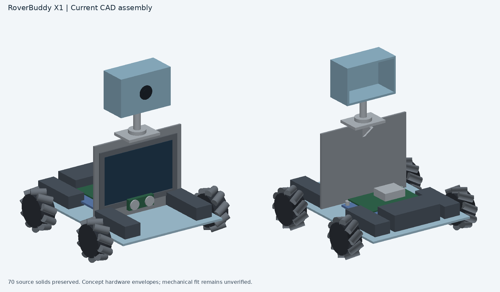
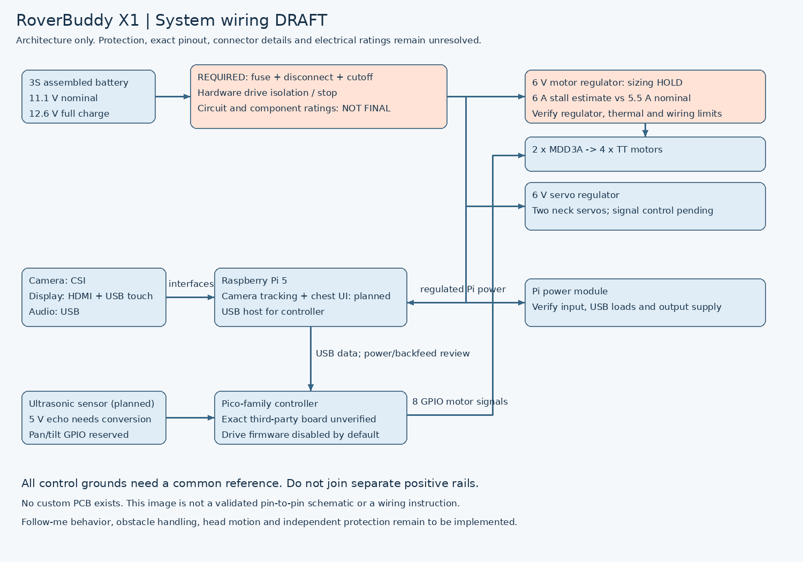

RoverBuddy X1
RoverBuddy X1 is a planned camera-guided companion robot with four mecanum wheels, a moving head and a chest display. I chose this project to combine robot movement, computer vision and a custom body in one build.
Status: design draft — no physical build or hardware testing yet. This repository is not a completed submission.
Current CAD assembly

The light-blue body and grey/silver details are the intended color scheme. The colored assembly retains all 70 solids from the supplied concept model. Electronics, wheels, motors and battery shapes are approximate references. Individual exports include both custom geometry and reference hardware; see parts manifest.
How to use the design
Open the assembly STEP in Onshape or another STEP-compatible CAD tool. Enable import appearances for colors.
Review the source link and CAD limitations before editing or printing. Individual part STEP files are in `cad/parts/`.
Review the BOM, wiring draft, and open tasks.
Run the firmware's desktop simulation with `python3 firmware/simulate.py`. It does not operate hardware. Read `firmware/README.md` before considering the MicroPython starter.
The intended finished workflow is to power the robot through a verified protection circuit, select a target and follow it while stopping for obstacles or a lost target. That behavior is planned; the current firmware provides only a drive-control starting point.
Electronics and wiring

The draft uses a Raspberry Pi 5, a Pico-family controller, two Cytron MDD3A dual motor drivers, four TT motors, a camera, HDMI display, ultrasonic sensor and two neck servos. The exact controller board pinout, motor directions, regulators, protection and connectors still require validation. This is a system diagram, not a completed fabrication schematic.
PCB: no custom PCB has been designed. Therefore there is no PCB screenshot, KiCad project or Gerber archive. See PCB status and exemption question. Acceptance of a module-only design has not been confirmed.
Known CAD/BOM differences
Item	Current concept	Required next step
Battery	75 × 40 × 24 mm envelope	Resize for selected 108 × 35 × 27 mm pack, connectors and retention
Display	Approximate 5-inch reference	Fit selected 121 × 89.48 mm display, mounting holes and cables
Wheels	Concept rollers and hubs	Replace with selected 60 mm left/right wheel references; confirm TT shaft fit
Motors	Approximate envelopes	Add exact motor cradles, fasteners and shaft clearances
Neck	Concept bearing/axis	Fit selected bracket, servos, horns, cable slack and travel limits
Electronics	Partial envelopes	Position both drivers, regulators, fuse, wiring and hardware stop
The 6 A combined motor stall estimate exceeds the selected motor regulator's nominal 5.5 A rating. Verify sizing before powering the motors. The automatic battery cutoff and drive isolation remain unresolved.
Files and verification
The package includes the assembly, 70 individual STEP exports, the latest BOM snapshot, a wiring draft, starter drive firmware and submission checklist. All individual STEP exports were reimported and checked for solid validity and retained volume. Desktop controller tests passed; no electrical, mechanical or on-robot verification has been performed.
No demo video or final product photos are available because this is currently a design project. The supplied submission rules require those additional items for a build submission.
